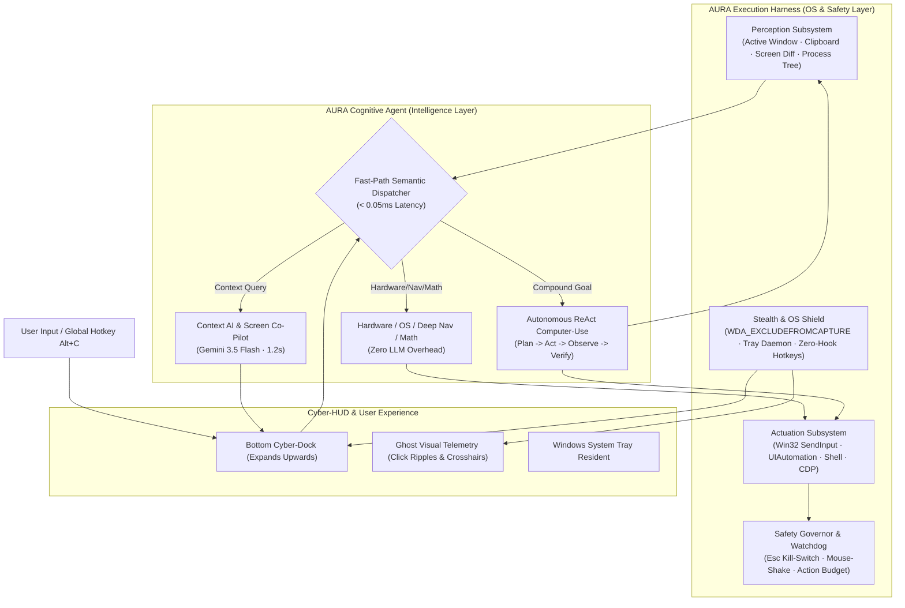

# AURA: Autonomous Desktop Cognitive Agent & Execution Harness

[](https://opensource.org/licenses/MIT)
[](https://www.python.org/)
[](https://microsoft.com)
[](https://ai.google.dev/)
[](#stream-stealth-architecture)

> **AURA** is an ambient, high-velocity cognitive desktop runtime and execution harness designed for high-performance developers, game engineers, and power users. It fuses an OS-level execution harness with a vision-grounded, multi-step agentic loop.

---

## ⚡ Architecture: The Harness + Agent Model

AURA decouples raw OS interaction into a protected **Execution & Safety Harness** and a cognitive **Agent Kernel**:



---

## 🌟 Key Features

### 1. 🛡️ Stream & Recording Stealth
AURA enforces native Win32 `SetWindowDisplayAffinity(hwnd, 0x11)` (`WDA_EXCLUDEFROMCAPTURE`) on both the CyberDock and the transparent telemetry overlay.
* **100% Invisible** on OBS Studio, Discord Screen Share, Zoom, Microsoft Teams, and screenshot tools.
* The assistant is rendered strictly on the local monitor's desktop compositing plane without leaking to streams or recordings.

### 2. ⚡ Sub-Millisecond Fast-Path Kernel (< 0.05ms)
Not every desktop instruction needs an LLM. AURA features a zero-regex layered dispatcher:
* **Instant Math Engine**: Computes expressions and percentages (`what is 15% of 850` $\to$ `127.5`) in `< 0.01ms`.
* **Platform Turbo Navigators**: Deep-links queries into Instagram (`ISWF video`), LeetCode (`two sum`), GitHub, YouTube, Reddit, and Twitter in `< 0.05ms`.
* **System Hardware Controls**: Real-time volume, mute, display locking, theme shifting, and workspace configuration.

### 3. 🧠 Grounded Vision & Context Co-Pilot (1.2s Latency)
* Powered by Google's latest **Gemini 3.5 Flash Lite** with session connection pooling.
* Ingests live environment context: focused application (`VS Code`, `Terminal`, `Godot`, `Chrome`), active window title, and clipboard stack traces.
* Triggers automatic screen ROI captures on visual queries (`"explain this error"`, `"what is on my screen"`).

### 4. 🔒 Complete Privacy & AI Anonymization
All outbound prompts pass through an active PII sanitizer:
* User paths (`C:\Users\username\...`) are stripped to `~/...`.
* IP addresses, personal credentials, and API secret tokens are masked prior to transmission.

### 5. 🤖 Autonomous Multi-Step Computer-Use (ReAct Engine)
Compound instructions (e.g. `"open chrome, navigate to github and search repo X"`) trigger the autonomous execution loop:
* Synthesizes hardware mouse glide trajectories using cubic Bézier curves (preventing robotic bot detection).
* Synthesizes keystrokes via microsecond Win32 `SendInput`.
* Resolves UI elements via accessibility tree traversal and visual landmarks.

### 6. 🛑 Hardware-Level Safety Circuit Breakers
* **`Esc` Panic Switch**: Dedicated 60Hz watchdog thread intercepts `VK_ESCAPE` to kill running autonomous loops in `< 10ms`.
* **Mouse Corner Flick**: Shaking or moving the cursor to the top-left screen corner instantly trips the circuit breaker.
* **Action Step Budget**: Prevents infinite loops by terminating tasks if execution exceeds step limits.

---

## 📊 Benchmark & Architectural Comparison

| Dimension | AURA 2.0 | Ghost App | Open Interpreter | Claude Computer Use | Flow Launcher |
| :--- | :---: | :---: | :---: | :---: | :---: |
| **Stream / OBS Stealth** | ✅ Native (0x11) | ⚠️ Partial | ❌ No | ❌ No | ❌ No |
| **Fast-Path Latency** | **< 0.05ms** | ~200ms | ~500ms | ~1500ms | < 1ms |
| **Cognitive Latency** | **1.2s - 1.8s** | 2.5s - 5s | 3s - 8s | 3s - 6s | N/A (Search only) |
| **Computer-Use Actuation** | ✅ Win32 SendInput | ✅ Custom | ✅ PyAutoGUI | ✅ API Container | ❌ Launch only |
| **Zero-Keylog Safety** | ✅ RegisterHotKey | ❌ Hooks | ❌ N/A | ❌ N/A | ⚠️ Mixed |
| **PII Anonymization** | ✅ Automatic | ❌ No | ❌ No | ❌ No | N/A |
| **Desktop Form Factor** | Bottom Cyber-Dock | Floating Overlay | Terminal CLI | API Headless | Center Bar |

---

## 🚀 Quickstart

### Prerequisites
* Windows 10 or Windows 11 (64-bit)
* Python 3.10+ (Anaconda / CPython)

### 1. Installation
```powershell
git clone https://github.com/arpit/aura-cognitive-harness.git
cd aura-cognitive-harness
pip install -e .
```

### 2. Configure Google AI Studio Key (Optional but Recommended)
AURA supports modern `AQ....` and standard `AIzaSy...` keys from Google AI Studio:
```powershell
python -c "from aura.agent.client import CLIENT; CLIENT.set_key('YOUR_GEMINI_KEY')"
```

### 3. Launch
Run via command line or double-click `run.bat`:
```powershell
python main.py
```

* **Summon Dock**: Press **`Alt + C`** or **`Ctrl + Alt + Space`** (or click the bottom dock).
* **Emergency Abort**: Press **`Esc`** at any time.
* **Minimize to Tray**: Click **`─`** or press **`Esc`** when idle.

---

## 🧪 Automated Test Suite

AURA includes a built-in verification suite:
```powershell
python tests/test_fastpath.py      # Validates < 0.05ms dispatch and math
python tests/test_perception.py    # Validates active window & PII anonymization
python tests/test_actuation.py     # Validates SendInput, safety circuit, and stealth
```

---

## 📄 License

Distributed under the **MIT License**. Free for personal, commercial, and research use.
