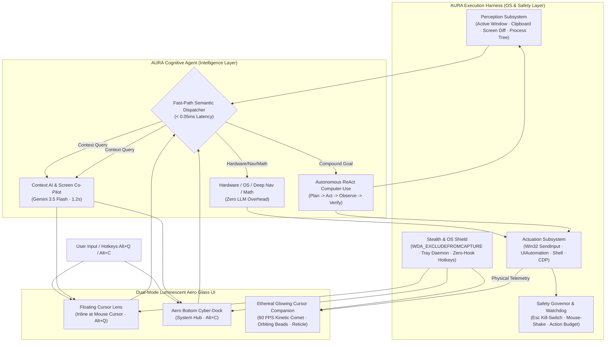

# AURA 2.1: Luminescent Cursor AI & Desktop Cognitive Harness

[](https://opensource.org/licenses/MIT)
[](https://www.python.org/)
[](https://microsoft.com)
[](https://ai.google.dev/)
[](#stream-stealth-architecture)

> **AURA** is an ambient, high-velocity cognitive desktop co-pilot and execution harness. It combines a 60 FPS **Luminescent Ethereal Cursor Companion**, an inline **Floating Cursor Lens (`Alt+Q`)**, and an OS-level execution harness backed by Google Gemini 3.5 Flash vision grounding.

---

## Architecture: The Harness + Agent Model

AURA decouples raw OS interaction into a protected **Execution & Safety Harness** and a cognitive **Agent Kernel**:



---

## Key Features

### 1. 🌟 Luminescent Ethereal Cursor Companion (60 FPS)
* **Fluid Ethereal Aura**: A subtle frosted glass/plasma glow tracks behind the mouse pointer with smooth inertia (Laguerre filter).
* **Kinetic Comet Wake**: Accelerating the mouse stretches a luminous comet wake with velocity-scaled ribbons.
* **Orbiting AI State Beads**: When the agent is reasoning or computing, dual luminescent photon beads orbit around the cursor ring.
* **Tactical Target-Lock Reticle**: Gliding to click UI elements illuminates targets with an animated lock-on bracket `[ ]` and laser guide beam.
* **Concentric Shockwaves**: Emits frosted glass circular shockwave rings upon physical clicks.
* **Toggle Companion**: Press **`Alt + T`** to toggle cursor glow on or off anytime.

### 2. 🔍 Floating Cursor Lens (Inline Cursor AI HUD)
* **Summoned at Cursor (`Alt + Q` / `Ctrl + Shift + Space`)**: Spawns an ultra-compact Aero Glass command palette directly adjacent to your mouse pointer.
* **Instant Context Awareness**: Automatically identifies the active window, selected code, or terminal output under the cursor.
* **Quick Actions**: One-click pills for `Explain`, `Fix / Code`, `Click Target`, and `Shell`.
* **Zero Disruption**: Press **`Esc`** to dismiss and immediately return to your active application.

### 3. 🎯 Multimodal Visual Grounding via Gemini Vision
* Solves UI element coordinates directly from live screen captures using normalized bounding box coordinates `[ymin, xmin, ymax, xmax]`.
* Maps targets onto absolute pixel coordinates and glides the glowing cursor physically to actuate them.

### 4. ⚡ Context Decorators & Semantic Routing
* `@screen <query>`: Forces immediate vision reasoning of whatever is on display.
* `@clip <query>`: Specifically references and explains clipboard text.
* `@git`: Instantly runs and displays repository status and diff telemetry.
* `> <command>`: High-speed terminal shell execution directly inside the Aero HUD.
* `* <math>`: Evaluates arithmetic and percentages in `< 0.05ms`.

### 5. 🛡️ Stream & Recording Stealth
* Native Win32 `SetWindowDisplayAffinity(hwnd, 0x11)` (`WDA_EXCLUDEFROMCAPTURE`) on the Dock, Lens, and Overlay.
* **100% Invisible** on OBS Studio, Discord Screen Share, Zoom, and screenshots.

---

## Benchmark & Architectural Comparison

| Dimension | AURA 2.1 | Cursor IDE | Ghost App | Open Interpreter | Claude Computer Use |
| :--- | :---: | :---: | :---: | :---: | :---: |
| **Stream / OBS Stealth** | ✅ Native (0x11) | ❌ No | ⚠️ Partial | ❌ No | ❌ No |
| **Floating Cursor Lens** | ✅ `Alt + Q` (Any app) | ✅ Inside IDE only | ❌ No | ❌ No | ❌ No |
| **Luminescent Cursor** | ✅ 60 FPS Comet & Aura | ❌ No | ❌ No | ❌ No | ❌ No |
| **Fast-Path Latency** | **< 0.05ms** | ~200ms | ~200ms | ~500ms | ~1500ms |
| **Visual Grounding** | ✅ Gemini 3.5 Flash | ❌ N/A | ✅ Custom | ❌ Visionless | ✅ API Container |
| **Zero-Keylog Safety** | ✅ RegisterHotKey | N/A | ❌ Hooks | ❌ N/A | ❌ N/A |
| **PII Anonymization** | ✅ Automatic | ❌ No | ❌ No | ❌ No | ❌ No |

---

## Quickstart

### Hotkeys Quick Reference
* **`Alt + Q`** or **`Ctrl + Shift + Space`**: Summon Floating Cursor Lens (at mouse cursor)
* **`Alt + C`** or **`Ctrl + Alt + Space`**: Toggle Bottom Aero Dock
* **`Alt + T`**: Toggle Luminescent Cursor Companion On/Off
* **`Esc`**: Emergency Abort / Dismiss HUD

### 1. Installation
```powershell
git clone https://github.com/Psychic-arpit/aura-cognitive-harness.git
cd aura-cognitive-harness
pip install -e .
```

### 2. Configure Google AI Studio Key (Optional but Recommended)
AURA supports modern `AQ....` and standard `AIzaSy...` keys from Google AI Studio:
```powershell
python -c "from aura.agent.client import CLIENT; CLIENT.set_key('YOUR_GEMINI_KEY')"
```

### 3. Launch
Run via command line or double-click `run.bat`:
```powershell
python main.py
```

* **Summon Dock**: Press **`Alt + C`** or **`Ctrl + Alt + Space`** (or click the bottom dock).
* **Emergency Abort**: Press **`Esc`** at any time.
* **Minimize to Tray**: Click **`─`** or press **`Esc`** when idle.

---

## 🧪 Automated Test Suite

AURA includes a built-in verification suite:
```powershell
python tests/test_fastpath.py      # Validates < 0.05ms dispatch and math
python tests/test_perception.py    # Validates active window & PII anonymization
python tests/test_actuation.py     # Validates SendInput, safety circuit, and stealth
```

---

## 📄 License

Distributed under the **MIT License**. Free for personal, commercial, and research use.
